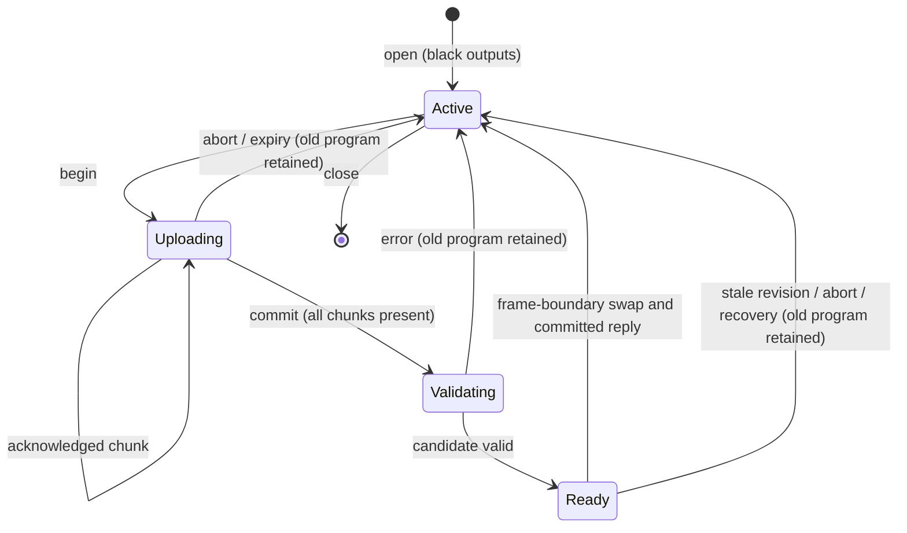

# Hydra native architecture — ADR 001

Date: 2026-11-12. Status: **design selected for implementation; not implemented**.
SCShader inspected at `94b9f1a03395d48b7b84a9386ad7c2951b44a137`.
Behavior reference: hydra-synth `9d29a9f4fd8f9081b9759943f38db36f05b9a88f`.
Scope: Step 03; subsequent steps implement and verify this contract. The
[inventory](HYDRA_API_MATRIX.md) remains a checklist, not a parity claim.

## Decision and integration boundary

`SCHydra` owns one opt-in session per `ShaderServer`; `SCHydraExpr` builds its
expressions. The Rust renderer validates a bounded typed IR and independently
generates WGSL. `scsynth` continues to supply audio/analysis through existing
bridges. No JavaScript runtime or browser is needed by the native renderer.

Add a focused `renderer/src/hydra/` module for IR, validation, code generation,
session state and GPU output resources. These paths are proposed, not existing.
`protocol.rs` parses new commands, `osc.rs` encodes replies and enforces transport
bounds, `app.rs` dispatches them, and `renderer.rs` hosts the optional Hydra GPU
state on its existing device. Reuse `wgpu::naga`, error scopes, window/input and
the Metal per-pass submission workaround. Do not route Hydra through legacy
`Controls::reflect`, whose group-0 ABI describes existing shaders.

The sole presentation selector is `Legacy` or `Hydra(output|quadrants)`.
Startup is Legacy. An explicit `h.render(...)` selects Hydra; `h.render(\legacy)`
returns to the existing active shader/linear graph. Creating, reloading or freeing
a legacy shader while Hydra is selected updates legacy state without taking
presentation ownership. Legacy-only clients behave as before. Hidden subsystem
histories freeze; control clocks and scheduled parameter deadlines continue.
Switching presentation preserves resources and resumes histories. This policy
must be documented because it affects feedback after a long pause.

`h.free` disposes the Hydra session and returns presentation to Legacy; it does
not quit `ShaderServer`. Server quit/window close disposes everything normally.
No existing OSC address, ready/status field, `ShaderGraph` meaning, or `\shader`
Event type is repurposed. A future `\hydra` Event targets parameter handles.

## Language objects, IDs and immutable upload snapshots

`SCHydra.new(server)` begins capability/session negotiation after the server boots.
`h.waitForReady { ... }` gates remote work; local expression construction is allowed
before readiness, but `.out`/`.render` fail clearly until ready. This avoids an
unbounded implicit queue and makes asynchronous startup explicit in Step 04.

- Both new classes derive from `Object`. The installed SC 3.14.1 library defines
  `Object.blend`, `repeat`, and `shape`; Hydra deliberately overrides relevant
  selectors on its own classes. Do not extend `Object`, `Function`, or `Array`
  globally. Project, standard library and the user's Extensions scan found no
  `SCHydra`/`SCHydraExpr` class declarations on this host; recheck on installation.
- Match Hydra's mutable chaining: a source creates an expression; chain methods
  append operations and return that expression. `.copy` must copy the builder
  graph explicitly. Nested references follow builder mutations until `.out` takes
  a deep, immutable snapshot. Detect a recursive object reference before traversal
  can recurse indefinitely. Mutations after snapshot creation cannot alter an
  in-flight or committed program.
- A node is a typed operation with an optional receiver, ordered argument values
  and nested expression references. Expressions form an acyclic DAG. Output reads
  are terminal references to slots, never expression edges; output feedback cycles
  are therefore permitted without an AST cycle or topological output sorting.
- SC allocates positive session-local node and parameter IDs monotonically, never
  reusing IDs before session close. IDs are not GPU resource IDs or user names.
  Wire node references use node IDs; parameters retain their IDs across snapshots.
  A node ID labels one operation snapshot within an upload, not a persistent
  renderer-side editable object. An edit replaces an output root atomically.
- Four output slots `o0..o3` have monotonically increasing revisions, initially 0.
  Every upload includes the expected old revision; commit compares again before
  activation. A parameter update names output and revision so a delayed event
  cannot modify a replacement patch accidentally. No counter wraps: exhaust an
  int32 ID space by closing/reopening the session after reporting the condition.

## IR and shader ABI

Use a compact binary expression document, not executable text or an unbounded
OSC argument list. The following is its readable representation, **not JSON sent
over OSC**. It describes `h.osc(10).rotate(0.2).out(\o0)` with defaults made explicit:

```text
HYIR 1.0
parameters: []
nodes:
  1: src   osc    receiver=none args=[f32(10), f32(0.1), f32(0)]
  2: coord rotate receiver=1    args=[f32(0.2), f32(0)]
root: 2
```

Wire encoding, all integers and floats in network byte order:

| Record | Fields |
| --- | --- |
| Header | ASCII `HYIR`, u16 major=1, u16 minor=0, u32 nodeCount, u32 parameterCount, u32 rootNodeID |
| Parameter, repeated parameterCount times | u32 parameterID, f32 initialValue |
| Node, repeated nodeCount times | u32 nodeID, u8 category (0=src, 1=coord, 2=color, 3=combine, 4=combineCoord), u8 argumentCount, u16 operationNameBytes, ASCII operation name, u32 receiverID (0 for src), then arguments |
| Argument | u8 tag followed by payload: 0=f32 literal; 1=u32 parameterID; 2=u32 expressionNodeID; 3=u8 sourceSlot; 4=u8 outputSlot; 5=four f32 vector components |

There is no inner padding; the outer OSC blob has ordinary OSC padding. IDs are
1..2^31-1 despite u32 storage. Slot indices are 0..3. Node records are ordered so
receiver/expression references name earlier records. Operation names are the
pinned inventory names; the receiver is separate, and combine/combineCoord take
their nested texture expression as argument zero. `src` takes a source/output
slot; `prev` takes no arguments. Defaults must be expanded by SC; Rust validates
exact arity/type against its own operation table. Unknown tags, duplicate IDs,
missing references, unreachable nodes, trailing bytes and nonfinite values fail.
Step 06 freezes byte examples and parser diagnostics in the protocol document.

Every node returns an expression color; `coord`/`combineCoord` describe how to
evaluate its receiver with changed UV. Compiler entry is conceptually
`eval(node, uv) -> vec4<f32>`: coordinate nodes transform UV then evaluate their
receiver; color nodes evaluate the receiver then alter the color; combination
nodes evaluate branches at the same incoming UV. Nested UV variables are private.
A shared node used at two different UVs must be evaluated twice or become a pure
function taking UV; it cannot be cached as one color solely by node ID.

Uniforms/bindings are private to Hydra pipelines:

| Binding | Contents |
| --- | --- |
| group 0 / binding 0 | Fixed aligned frame block: time/speed/BPM/delta, resolution/inverse resolution, pointer state and frame counter; exact offsets frozen with Step 07 |
| group 0 / binding 1 | `array<vec4<f32>,64>` for up to 256 numeric parameter values; deterministic slots sorted by parameter ID |
| group 1 / binding 0 | Nearest min/mag, clamp-to-edge, non-mipmapped sampler |
| group 1 / bindings 1..4 | `s0..s3` RGBA textures, transparent-black fallback when empty |
| group 1 / bindings 5..8 | `o0..o3` read views resolved for the current destination pass under the temporal rules below |

Use separate per-output frame/parameter buffers so queued writes for one pass
cannot overwrite another pass's constants before submission. Generated identifiers
are deterministic (`n<ID>`, `p[slot/4][slot%4]`); no user string is spliced into
WGSL identifiers. Device limits must accommodate this layout before advertising
the relevant capability. Only the required output passes execute, then a small
presentation pass samples their latest images; overlay is added afterward.

## Math, parameters and compatibility decisions

- Arithmetic is f32 in shaders. CPU clock accumulation uses f64 and converts for
  upload. Native precision corresponds to a high-precision implementation; exact
  equality to browser mediump quantization is not promised.
- Time starts at zero on session open, is measured in seconds, and accumulates
  renderer-monotonic delta times speed (default 1); BPM defaults to 30. A speed
  change preserves time continuity. Uniform time is shared across all four passes
  of a frame. No shader/GPU work runs on the SC audio thread.
- Use normalized bottom-left visual UV to match the reference. Adapt framebuffer
  and decoded-source row orientation explicitly; the shader ABI must not inherit
  WebGPU's framebuffer Y direction accidentally. `src`/`prev` apply wrapped UV;
  other coordinate wrap/offset rules follow their individual source expressions.
- Output histories are non-sRGB `Rgba8Unorm`, with replace blending. Intermediate
  shader RGBA remains unclamped; output storage saturates/quantizes to 8-bit UNORM.
  Decode/source adapters declare orientation and color conversion. Do not silently
  use the window's possibly sRGB format for history or apply an extra transfer
  function during presentation. Prefer a compatible non-sRGB surface view; if the
  selected surface requires sRGB conversion, compensate explicitly in the presenter.
  Verify grayscale ramps against the reference.
- Alpha is operator-specific: e.g. blend interpolates RGBA, layer uses second
  alpha to mix RGB and clamps the alpha sum, mask multiplies by second luminance,
  and channel extraction writes its result into all four channels. Implement the
  pinned math independently; WGSL `fract`/modulo and vector/matrix conventions
  require explicit equivalents, not text substitution from GLSL.
- Literal scalars/vectors are structural. Explicit parameter handles are mutable
  numeric leaves; their updates write uniforms without recompilation. New snapshots
  specify initial values; existing last-valid values remain until successful commit.
  An expression-to-float conversion is an explicit channel-reduction operation at
  lowering, never accidental WGSL type coercion; exact `sum` conversion behavior
  must be tested against the reference before advertising that capability.
- Arrays/sequences later become bounded native parameter evaluators, evaluated at
  the common renderer frame time. Numeric updates override the current value under
  an explicit handle. General SC Function callbacks execute at a documented bounded
  language control rate and send numeric updates; they do not claim browser
  per-render callback timing. No arbitrary SC/JS code crosses OSC.
- Explicitly reject NaN/Inf at transport and API boundaries. Shader-domain errors
  such as division by zero are not silently repaired with arbitrary epsilons;
  define/check each operation where needed and disclose native differences.
- `prev()` is deliberately defined as the destination's last completed output,
  equivalent to self `src(oN)` in the native engine. The reference's `prevBuffer`
  callback can select its active render attachment (evidence below); reproducing
  that undefined read/write alias is not a supported compatibility behavior.
  Fixed numeric vectors for `sum` are accepted by the typed native API; upstream's
  broad vec4 argument guard has JavaScript-specific rejection cases. These are
  explicit native semantics, not claims of bit-identical JavaScript execution.

## Temporal contract: match observable safe output reads

The Hydra commit alone does not determine callback evaluation order. Its
`package-lock.json` pins **regl 1.7.0**; the downloaded package was verified against
its SHA-512 integrity value (see evidence below). In that package's `lib/core.js`,
`emitDrawProc` emits `emitPollFramebuffer` before `emitDrawBody`; the latter emits
texture uniforms. Thus Hydra toggles the destination index before sampling inputs.
Hydra's `getCurrent()` returns that index, while `getTexture()` returns its opposite.

For each output `i`, keep two textures and `last[i]`, the most recently written
index (initially 0; both textures explicitly cleared to transparent black).
Unassigned outputs retain two logical black images and need no full-size allocation.
At each presented Hydra frame, render assigned outputs in fixed order 0,1,2,3:

1. Choose destination `dst = 1 - last[i]` without publishing it as complete.
2. Resolve self `src(oi)` and `prev()` to `textures[i][last[i]]`.
3. Resolve another output `src(oj)` to `textures[j][1 - last[j]]`, using `last[j]`
   at this point in the output loop. Source slots are snapshotted once per frame.
4. Encode the pass; submit in order using the existing Metal split policy where
   enabled. Only after successful encoding/submission update `last[i] = dst`.
5. Present `textures[display][last[display]]`, or the four latest views in quadrants.

For outputs continuously assigned since startup, with frame being computed `n`:

| Read by destination i | Selected completed image |
| --- | --- |
| self `src(oi)` / native `prev()` | i at n-1 |
| other output j < i, already drawn this frame | j at n-1 |
| other output j > i, not drawn yet this frame | j at n-2 |
| unassigned output | transparent black |

Example: `o0 = frame-tag; o1 = src(o0)` reads o0's previous tag; reversing the
assignments so `o0 = src(o1)` reads o1's older tag. Stopped/unassigned outputs use
their actual two retained images rather than a fictitious global frame number.
This reproduces the pinned `src` indexing; uniform previous-frame snapshots would
change the forward-reference case. **No same-frame output edge is exposed in ABI 1.**
Nested expression combinations are same-pass evaluation, not output-buffer edges.

Only resolved read textures go into bind groups; self's write attachment must
never be bound as a sampled view, even in an unused binding. Multiple reads of
one output within a pass use the same resolved view. Do not reuse legacy graph's
two scratch textures for Hydra histories. A failed surface acquisition performs
no output index swap. A device loss after partial submission clears all histories
under the existing recovery contract; partial-frame history is never reconstructed.

This is source-derived behavior, **not browser GPU parity verification**. Step 13
must verify self/lower-index/higher-index reads with changing frame colors against
the pinned upstream and native GPU, plus unassigned outputs and the documented
`prev` difference. If those results contradict the source derivation, correct this
ADR and the implementation before claiming temporal parity.

## Bounded transport and atomic replacement

Current limits are 65,535-byte receive storage, 256 incoming packets, 256 packet
elements, depth 16, and an 8,192-command / 16 MiB / one-hour future scheduler.
These are ceilings, not a safe single-message upload target. Existing SC float
buffers already chunk to avoid the macOS UDP ceiling. Hydra uses staged 2 KiB
blobs and stop-and-wait acknowledgement; at most one upload is active per session.

Initial ABI 1 limits (advertise, validate before allocation, never silently truncate):

| Resource | Limit |
| --- | --- |
| Sessions per renderer | 1, owned by one sender endpoint and opaque boot epoch |
| Staged IR | 64 KiB, 32 chunks of at most 2,048 bytes |
| Upload timeout | 10 seconds idle; 30 seconds absolute, renderer-monotonic time |
| IR nodes / reference depth | 256 / 64 |
| Arguments per node / operation name | 16 / 48 ASCII bytes |
| Numeric parameters / generated WGSL | 256 / 256 KiB |
| Expanded operation instances per output | 4,096, charged before code generation to bound DAG expansion |
| Live pipeline cache | At most four active output programs plus one candidate; share identical live pipelines, no unbounded inactive cache |
| Transaction result records | Latest 32 mutation results; bounded error text under existing diagnostic budget |
| History dimensions / storage | Each axis ≤ min(4096, device limit); ≤256 MiB for allocated output histories total; ≤512 MiB old+new during resize |

First implementations may advertise fewer operations/features, but must advertise
actual limits. Reject unsupported operations before compiling. Do not advertise
Tier A completion based on a successful handshake. Keep texture allocation estimates
in existing total texture bytes, and expose Hydra detail through its own status.
Source/media cache budgets are added before those capabilities become available.

Compilation starts after a complete commit request. Validate lengths, topology,
types, caps and references, generate WGSL, validate with Naga, then create the
candidate pipeline under a wgpu validation error scope. Check expected revision
and session/device generation again, and activate at a renderer frame boundary.
Only then increment the output revision and report `committed`. A failed candidate
leaves pipeline, uniforms, histories and presentation unchanged. Successful program
replacement preserves the output's histories; resize/hush/close explicitly clear.

Compile one bounded candidate on the renderer thread initially, consistent with
existing shader reload. This can delay rendering and the OSC queue; the 2 ms
dispatch service target is not a hard compile deadline. Do not introduce a worker
framework to promise bounded driver compilation time. If profiling demonstrates
stalling, move CPU validation/codegen to one bounded worker with generation checks;
GPU installation remains renderer-owned. Repeated commits do not create a backlog.



The active program keeps rendering during Uploading and Ready; Validating may
briefly block. Closing from any state disposes the session. Startup/recovery
failures still follow SCShader's existing fatal policy.

## Proposed OSC contract

All addresses below are prefixed **`/scshader/v1/hydra/`**. This is a proposal for
Step 06, not an available API. Except capability/open messages, every message
starts with `epoch:string, session:int`. The boot epoch is a ≤64-byte opaque token
unique to this renderer process; handles are positive and never reused within
that epoch. They are stale-message guards, not authentication. Bind ownership to
the UDP sender endpoint and negotiated loopback reply port. No new network listener.

| Suffix | Arguments after common prefix | Effect / response |
| --- | --- | --- |
| `capabilities` | No common prefix: `request:int, abiMajor:int, replyPort:int` | `capabilities.reply(request, epoch, abiMajor, abiMinor, limitsBlob, features:string)`; reply ≤4 KiB |
| `open` | No common prefix: `request:int, epoch:string, clientNonce:string, abiMajor:int, replyPort:int` | `opened(request, epoch, session)`; allocate lightweight CPU state, leave Legacy selected |
| `begin` | `tx:int, output:int, expectedRevision:int, totalBytes:int` | Reserve bounded staging, return `ack(tx, -1)` |
| `chunk` | `tx:int, index:int, bytes:blob` | Store indexed bytes, `ack(tx,index)`; exact duplicate accepted, conflicting duplicate rejected |
| `commit` | `tx:int` | Complete snapshot → validation/compile → frame-boundary activation → `committed(tx, output, revision)` |
| `abort` | `tx:int` | Discard uncommitted staging/candidate; `aborted(tx)`; committed transaction cannot be undone |
| `status` | `request:int, tx:int` (0 for session only) | `status.reply(request, mode, revisionsBlob, transactionState, code, message)`; bounded ≤4 KiB, enough to resolve a lost result |
| `params` | `output:int, revision:int, sequence:int, pairs:blob` | Atomic set of ≤256 unique `(u32 parameterID,f32 value)` pairs; no per-frame success reply |
| `present` | `sequence:int, mode:int` (-1 Legacy, 0..3 output, 4 quadrants) | Validate and select at frame boundary; `presented(sequence,mode)` |
| `hush` | `sequence:int` | Idempotently cancel candidate, clear output programs/histories and source slots, bump output revisions, show black o0; `hushed(sequence)` |
| `close` | `request:int` | Dispose session, return presentation to Legacy; `closed(request)` |

Every session reply starts with the same epoch/session. Limits blob is a
versioned network-order u32 table in the limit-table order above, frozen in Step 06;
features lists supported operator names and optional services. Do not claim a
feature before its command and renderer path exist. Revision/status blobs have
fixed documented order `o0,o1,o2,o3`. Error reply is
`error(txOrRequest:int, output:int, nodeID:int, code:string, message:string)` with
the common prefix. Use stable codes `VERSION`, `SESSION`, `LIMIT`, `UPLOAD`,
`STALE`, `IR`, `TYPE`, `COMPILE`, `CAPABILITY` (each prefixed `E_HYDRA_`). Diagnostics
use the existing 20/s burst-20 budget and 4096-byte message bound. Generic parse
errors may still use the existing `/scshader/v1/error`; all client waits time out.
Status truncates its embedded reason to keep the entire reply within 4 KiB.
`clientNonce` is at most 64 ASCII bytes; validate all IDs, ports and string lengths
before allocating state. Reject unknown IR/ABI versions rather than guessing a
layout. An identical begin retry for a completed transaction returns its retained
terminal result, never new staging.

Ordering/retry rules:

1. Probe only after ordinary `ShaderServer` readiness. An old renderer's unknown
   address error or timeout means Hydra unavailable; do not send subsequent Hydra
   commands or guess compatibility from the renderer version. New renderers keep
   the old `/ready` schema and legacy paths unchanged.
2. Retrying `open` with the same owner/nonce returns the existing handle; another
   owner/nonce gets a session-busy error. `close` releases it. There is no implicit
   idle lease that could kill a performance when SC is temporarily busy.
3. Transaction IDs increase monotonically. Only one staging/ready candidate exists;
   a second `begin` is rejected until completion/abort. Identical `begin` retries
   acknowledge the current transaction. Chunks can arrive reordered but must cover
   exactly the declared length; the last chunk has the exact remainder length.
4. Repeated commit returns pending or the retained terminal result and never
   recompiles/reapplies it. Retain the latest 32 results and a transaction high-water
   mark. An evicted ID reports stale/unknown result and cannot execute again; status
   revisions establish the current state. Retry at most three times with 250 ms
   backoff for upload acknowledgements; query a commit timeout before a new edit.
   SC keeps one in-flight snapshot and at most one latest waiting edit per output.
5. Structural messages are immediate only. Reject non-immediate timetags for them
   before the future scheduler, including inherited bundle times. `params`/`present`
   may use the existing scheduler; counts/heap bytes include Hydra payloads. Params
   are continuous updates subject to existing drop policy; structural messages are
   not. Newer parameter sequence wins per output revision; newer presentation
   sequence wins per session. Senders assign sequences in intended application
   order, and discard stale updates rather than applying UDP arrival order blindly.
6. Direct bundle members still dispatch consecutively; only a Hydra commit replaces
   one output atomically. Multiple output commits in a bundle are not a multi-output
   transaction. `hush`/close reject pending candidates and invalidate queued updates
   through revisions/session handles. Client hush also stops local callbacks and
   producer tasks. Present and hush share one monotonic session control sequence;
   hush advances its high-water mark so older delayed/scheduled presentation commands
   cannot take ownership back. A repeated hush sequence returns its retained result
   without clearing later edits; IDs at or below its high-water mark are stale
   after eviction. Hush results share the 32-entry
   result budget with transactions, keyed by operation kind. Read-only status and
   parameter traffic do not evict mutation results. Close is idempotent for the
   latest closed handle; older closed handles report stale and cannot affect a
   subsequently opened session.
7. Diagnostics may be suppressed or UDP replies lost. Store transaction outcomes
   independently of error delivery; status is the reconciliation path. Late packets
   after process restart fail the epoch guard. Process restart requires a new
   session and explicit replay; no general scene-restoration framework is added.

## Ownership, replacement and recovery

| Resource | Owner / release point | Retained CPU state for one device recovery |
| --- | --- | --- |
| SC builders, parameters, callbacks, OSC responders | SCHydra; cancel on free/server exit | Language state stays local; no automatic restart claim |
| Upload bytes, transaction records | Renderer Hydra session; expiry/abort/close | Abort incomplete/uncommitted work on loss with recorded terminal error |
| Accepted IR, generated WGSL, parameter mapping/values, revisions | Renderer Hydra session; replacement/close | Retain last-valid content, clocks and IDs; never reread source files |
| Four output texture pairs, per-output uniforms and bind groups | Hydra GPU state; resize/close/recovery | Recreate from descriptors; clear GPU history to transparent black |
| Live/candidate pipelines | Hydra GPU state; final reference drop after replacement/abort | Recreate only accepted programs; discard candidate generation |
| Source slot attachments | Hydra session; replacement/clear/close | Source adapters own decoded data/decoder lifecycle and explicit bounds |
| Existing Shader/Graph/resources | Existing renderer owners | Existing recovery snapshots and semantics |
| Window, device, surface, command queue | Existing renderer | Existing single recovery attempt and fatal policy |

Do not borrow a legacy texture by a bare ID and assume it outlives a Hydra binding.
Step 19 must introduce a checked retained resource handle (or an independently
owned decoded-image source adapter); freeing the public ID cannot leave a dangling
GPU/CPU reference. `ShaderBus.map` currently requires a `Shader` instance, so reuse
for Hydra needs an explicit `SCHydra` parameter adapter rather than pretending the
existing map accepts new expression objects. It can read existing bus values at
the language control rate without new audio polling or audio UGens.

On ordinary program replacement, retain output histories and source attachments,
drop only obsolete pipelines/bind groups after queued commands have retained their
wgpu handles, and avoid an ever-growing retirement list. At most four accepted
programs and one candidate coexist. No CPU wait is
needed per frame to free handles safely.

Resize allocates/clears a complete new set within the advertised steady/transient
budgets before switching all histories. Zero-sized/occluded surfaces do not advance
history. If a requested size exceeds budget/device limits, keep the last valid
Hydra resolution and report `E_HYDRA_LIMIT`; presentation may scale it to the window
and status must report the retained resolution. An explicit resolution change
fails atomically. Do not silently discard outputs to fit memory.

The existing one-attempt device recovery also reconstructs accepted Hydra state;
histories reset, revisions/parameter IDs and presentation selection survive, clocks
remain continuous, and the existing recovered notification reports history reset.
Incomplete uploads and candidate commits terminate with an upload/recovery reason;
status resolves any missing reply. Uncaptured device validation/OOM and failed
recovery retain the existing fatal policy. Successful last-picture rollback is a
promise for rejected input/compilation, not for driver loss or process failure.

## Rejected alternatives and implementation gates

| Alternative | Reason for decision |
| --- | --- |
| Browser/JS host for Tier A | Adds a second runtime and changes the native process model |
| Extend `/graph/set` to carry Hydra DAGs | Breaks its documented linear semantics and old clients |
| SC-generated WGSL in one OSC packet | Couples ABI/codegen to SC, exceeds practical datagram size and lacks atomic bounded staging |
| JSON IR with new parser dependency | Typed binary fits current blob conventions and pinned dependencies; no general serialization framework needed |
| Uniform previous-frame reads or topologically sorted outputs | Changes the pinned output-index history semantics |
| Per-frame compilation / inactive global shader cache | Adds live-coding stalls and unbounded resource growth |
| Async compiler pool immediately | Current renderer already compiles on its owner thread; add concurrency only for demonstrated need |

Steps 04–08 specify and implement only `osc → rotate → o0`, capability negotiation,
bounded snapshots, commit rollback and presentation. Later feature capability bits
remain absent until their implementations pass focused checks. Step 13 owns native
temporal pixel proofs. Step 22 defines a separately bounded custom-function schema
with WGSL validation, registry generations, and signature checking before advertising
`setFunction`; it cannot smuggle unrestricted resources or imports into this ABI.

Architecture checks performed: source/contract inspection, installed class-name
scan, pinned dependency integrity verification, and paper derivation of buffer
selection. No Hydra runtime, browser GPU, native GPU or SC class implementation was
executed for this ADR. The pinned Rust baseline was separately corrected and rerun
as recorded in [BASELINE.md](BASELINE.md). The native `prev` definition is a
documented compatibility difference requiring explicit coverage in Step 13.

## Source evidence

- SCShader: [protocol](../../protocol/protocol.md), [OSC bounds](../../renderer/src/osc.rs),
  [scheduler](../../renderer/src/scheduler.rs), [render/recovery](../../renderer/src/renderer.rs),
  [device recovery policy](../RECOVERY.md), [Metal workaround](../MEMORY_INVESTIGATION.md).
- Pinned Hydra: [output buffers](https://github.com/hydra-synth/hydra-synth/blob/9d29a9f4fd8f9081b9759943f38db36f05b9a88f/src/output.js),
  [output tick order](https://github.com/hydra-synth/hydra-synth/blob/9d29a9f4fd8f9081b9759943f38db36f05b9a88f/src/hydra-synth.js),
  [argument evaluation](https://github.com/hydra-synth/hydra-synth/blob/9d29a9f4fd8f9081b9759943f38db36f05b9a88f/src/format-arguments.js),
  [lockfile](https://github.com/hydra-synth/hydra-synth/blob/9d29a9f4fd8f9081b9759943f38db36f05b9a88f/package-lock.json).
- regl 1.7.0: [command compiler](https://github.com/regl-project/regl/blob/v1.7.0/lib/core.js),
  `emitDrawProc`, `emitPollFramebuffer`, `emitDrawBody`, `emitUniforms`. Package archive
  integrity from Hydra lockfile:
  `sha512-bEAtp/qrtKucxXSJkD4ebopFZYP0q1+3Vb2WECWv/T8yQEgKxDxJ7ztO285tAMaYZVR6mM1GgI6CCn8FROtL1w==`.
  Only reference source was read; it is retained under ignored `build/` and not
  copied into native code. License review remains necessary before any future
  upstream implementation copying or translation.
